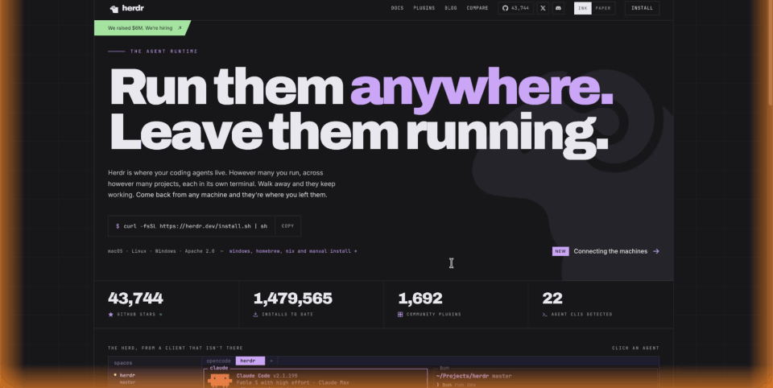

# Herdr Glow

**An ambient edge glow for when your Herdr agents need you.**

[한국어](README.md)



When a coding agent in [Herdr](https://herdr.dev) becomes `blocked` (waiting on an
approval or a question), Herdr Glow lights up the edges of your screen with a soft,
breathing glow. It sits on top of every Space, monitor, and full-screen app, and it
never takes clicks or keyboard focus.

It is built so you don't miss a prompt when you step away, without nagging you when
you are right there:

1. **Short pulse.** The moment an agent becomes blocked, the glow breathes twice
   (about 5.6 s) and fades out.
2. **Comes back when you're away.** If the agent is still blocked and you haven't
   touched the keyboard or mouse for 30 s, the glow returns and keeps breathing.
3. **Fades on input.** Touch the keyboard or mouse and it fades out. If you leave
   again while the agent is still blocked, it returns after another 30 s.
4. **Stops when unblocked.** It disappears once no agent is blocked, or when the
   blocked pane closes.

If you're already away when an agent blocks, it skips the short pulse and glows
straight away. With several blocked agents there is still just one glow, and it
stays until the last one is unblocked.

When an agent becomes blocked or done, a pill-shaped toast also appears at the
bottom center of the screen for 4 s, naming the agent (e.g. `herdr-glow · Claude  is done`).

## Quick start

Requirements:

- macOS
- A running [Herdr](https://herdr.dev) 0.9.0 or later
- Xcode Command Line Tools (`xcode-select --install`), used to compile the small Swift helper

```sh
herdr plugin install DevooKim/herdr-glow
```

That's all. The plugin builds its helper on install and starts reacting to agent
status changes right away. There are no actions or shortcuts to set up.

To remove it:

```sh
herdr plugin uninstall devookim.herdr-glow
```

## Turning it off

The glow turns off once no agent is blocked. If it sticks
around anyway, the `dismiss` action forces it off until an agent's status changes again.

```sh
herdr plugin action invoke devookim.herdr-glow.dismiss
```

To bind it to a key, add this to Herdr's `config.toml`:

```toml
[[keys.command]]
key = "prefix+g"
type = "plugin_action"
command = "devookim.herdr-glow.dismiss"
description = "dismiss glow"
```

## How it works

The plugin subscribes to Herdr's `pane.agent_status_changed`, `pane.closed`, and
`pane.exited` events. `bin/on-status-changed.sh` tracks which panes are blocked and
starts or stops `bin/glow`, a single-file Swift/AppKit helper (`src/glow.swift`). When a pane newly turns blocked or done it also shows `bin/toast` (`src/toast.swift`), which looks up the agent and workspace names with `herdr agent get` and `herdr workspace get`.

`glow` only runs while an agent is blocked. It draws a transparent, click-through
window with gradient edges, polls the system idle time once a second, and exits when
the hook sends it a signal. It needs no extra permissions. While running it uses
about 40 MB of memory and no measurable CPU.

## Customize

Edit the `glow` line in `bin/on-status-changed.sh` inside the plugin directory
(`herdr plugin list` shows where it lives). Colors are set by `BLOCKED_COLOR` (default `FF8A1F`) and `DONE_COLOR` (default `34C759`) at the top of the script.

```sh
"$DIR/glow" --color "$WANT" --width 60 --watch --idle 30 --intro 5.6
```

| Option | Default | Meaning |
| --- | --- | --- |
| `--color RRGGBB` | `FF8A1F` | Glow color |
| `--width PT` | `140` (hook uses `60`) | Glow thickness in points |
| `--watch` | off | Short pulse, then glow again while you are idle |
| `--idle SEC` | `30` | Idle time before the glow returns |
| `--intro SEC` | `5.6` | Length of the short pulse |
| `--duration SEC` | `3` | One-shot pulse without `--watch`; `0` glows until stopped |

You can also try it by hand. Stop it with `Ctrl+C` or `pkill glow`.

```sh
bin/glow --duration 0 --width 60
```

After editing `src/glow.swift`, rebuild with:

```sh
swiftc -O src/glow.swift -o bin/glow
```

## Limitations

- macOS only. The overlay uses AppKit.
- The glow shows on the displays connected when it starts.
- `blocked` (orange) is tracked until it clears; `done` (green) pulses once and never returns on idle. If the blocked glow is already on, done shows only the toast. `idle` does not trigger anything.

## License

MIT
